*Strange(r) Loops* is an interactive sound installation created by The Algorithmic Gaze for the [SLARG Research Exhibition 2026](https://slarg.be/research-week/2026/slarg-research-exhibition/) at Sint Lucas Antwerpen. It is part of our ongoing artistic research project [*Strange Loops*](/projects/strange-loops/) (2024–2027), where we explore *transmediations*: translating one form of expression into another, from movement to tactile vibration, and from physical presence to sound.

In our earlier performance [*Assume calibration pose*](/collaborations/assume-calibration-pose/), a dancer's movements sent vibrations to gloves worn by an oboist, who answered by playing her instrument. It created an intimate connection between the two performers, but one that only they could feel. With *Strange(r) Loops*, we wanted to open that somatic feedback loop up to the audience. Four tall metal panels hang in the showroom, responding to the people walking between them. There is nothing to wear and no interface to figure out: you simply walk slowly between the plates and feel the vibration.

  <iframe class="embed-responsive-item" src="https://www.youtube.com/embed/d-ZncBq3v9o"></iframe>

## Sound you can feel

Each panel is a thin, two-metre-high sheet of steel suspended from wires in front of a plywood wall, dividing the space into three narrow alcoves. Mounted to each plate is a single audio exciter that drives the metal directly, turning the whole surface into a resonating body. Low frequencies travel through the steel as a physical tremor you can feel in the air (or under your hand if you lean in), while higher tones ring out across the room.

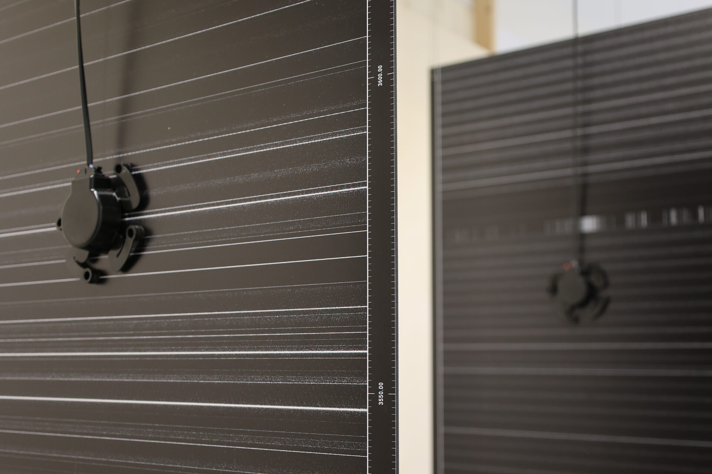

  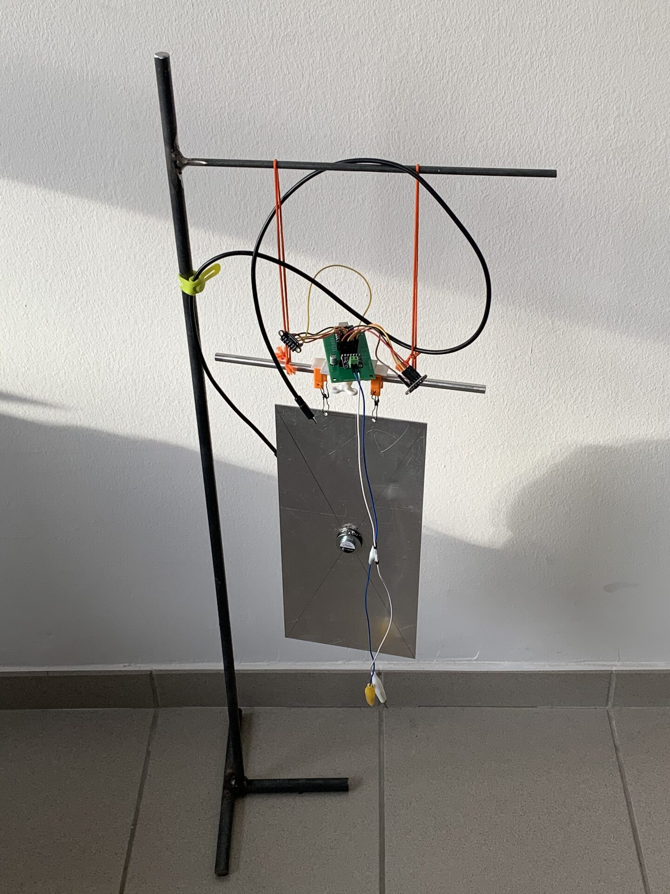
  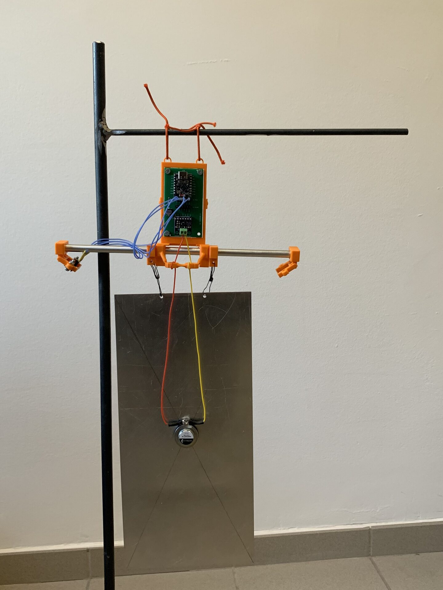

We started with small metal plates, outfitted with tiny piezoelectric buzzers, clamped to stands in the studio to get a feel for how different dimensions and thicknesses resonated, before hanging full-size panels in the lab to experience how they behaved together in a room.

  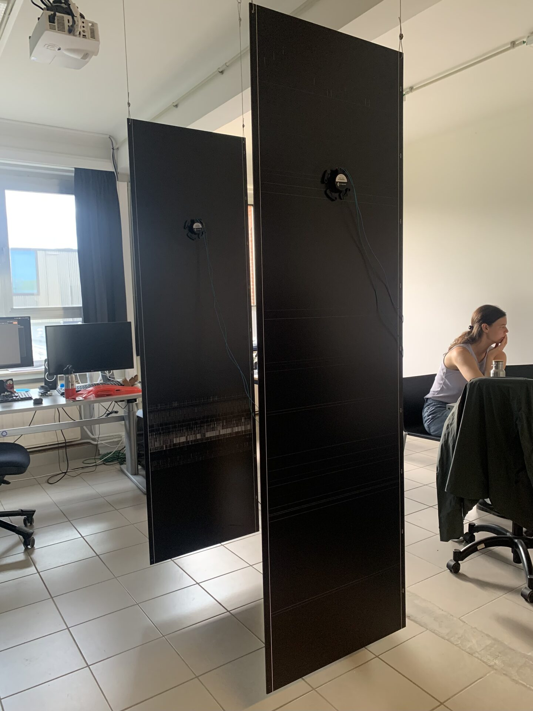
  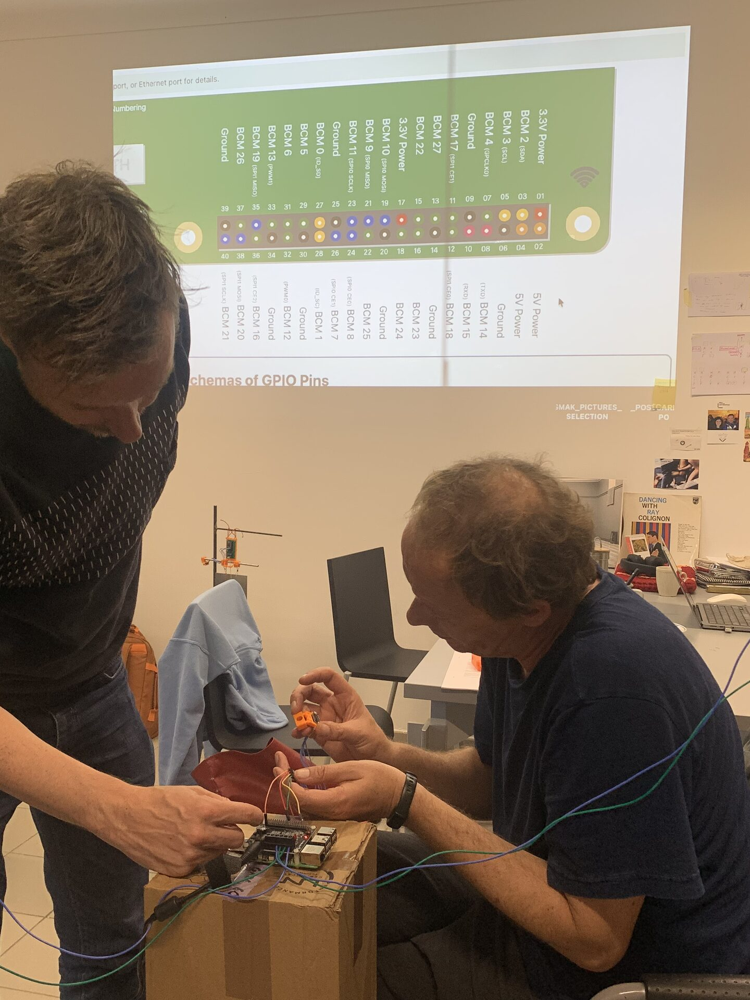

In the final setup, all the sensing is tucked into the plywood wall behind the plates, where small sensors detect when someone steps into an alcove.

  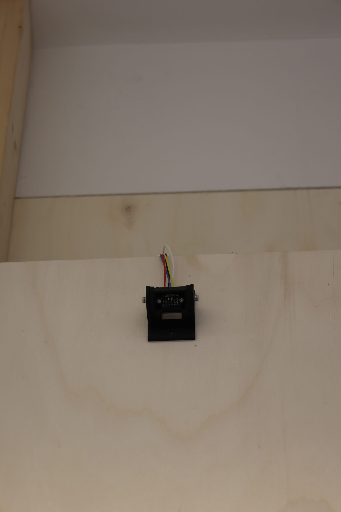
  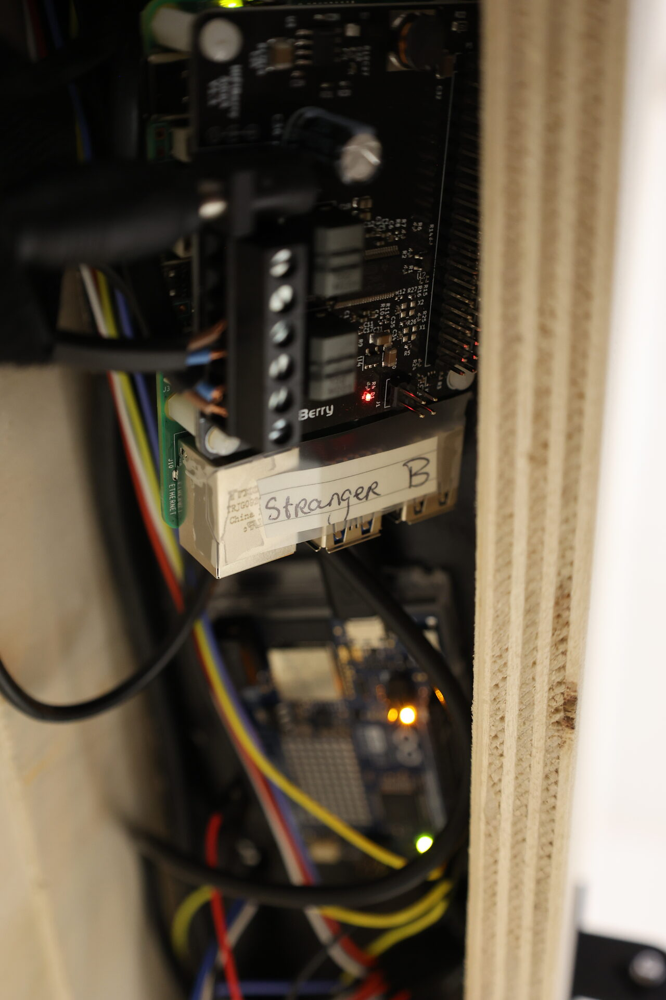

Because metal plates colour sound very differently from loudspeakers, we built a custom browser-based patcher so we could compose directly in the room, standing between the hanging sheets and listening as we tweaked each voice.

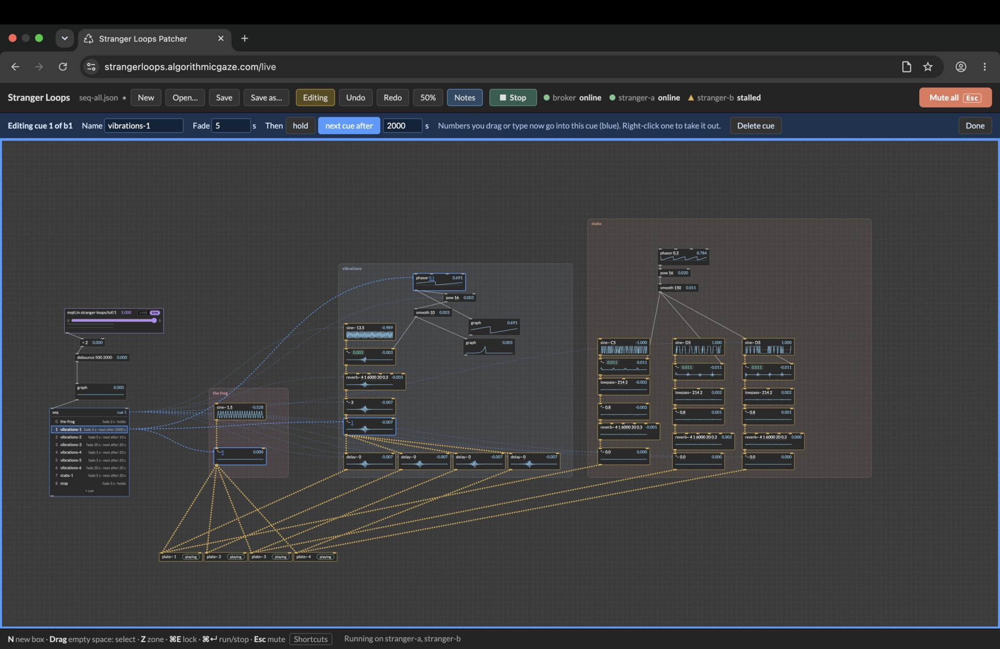

The composition we made for the exhibition responds to how long you linger. As you step between two panels, the piece begins with a set of low vibrations that gradually grow in strength and density. Stay a little longer and the pulses sharpen into rhythmic stabs, which slowly gather into chords and, eventually, a small melody.

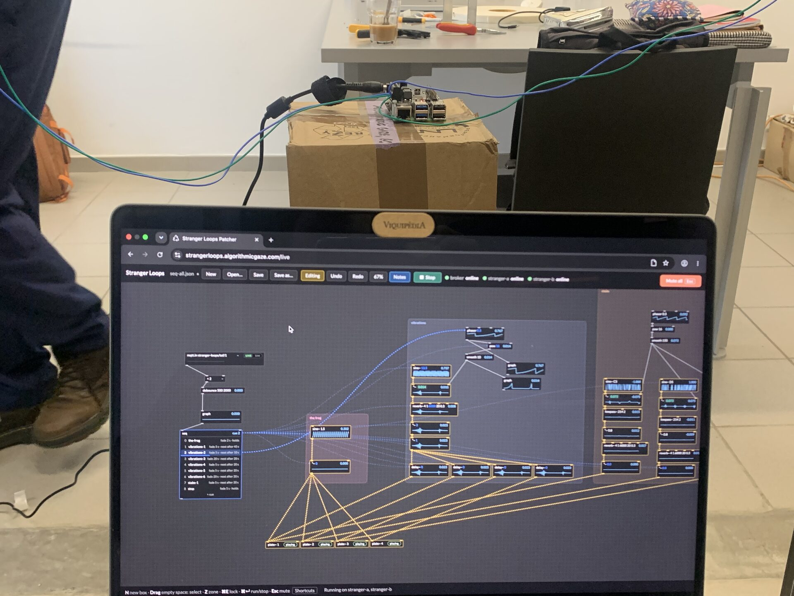

Because each visitor decides when to step into an alcove, and therefore when their sequence starts, the timing is never fixed. On top of that, the two inner panels are shared between neighbouring spaces, carrying vibrations from both sides at once. Two people standing in adjacent alcoves end up blending their sequences through the same sheet of metal, so the installation sounds and feels different every time you walk through it.

  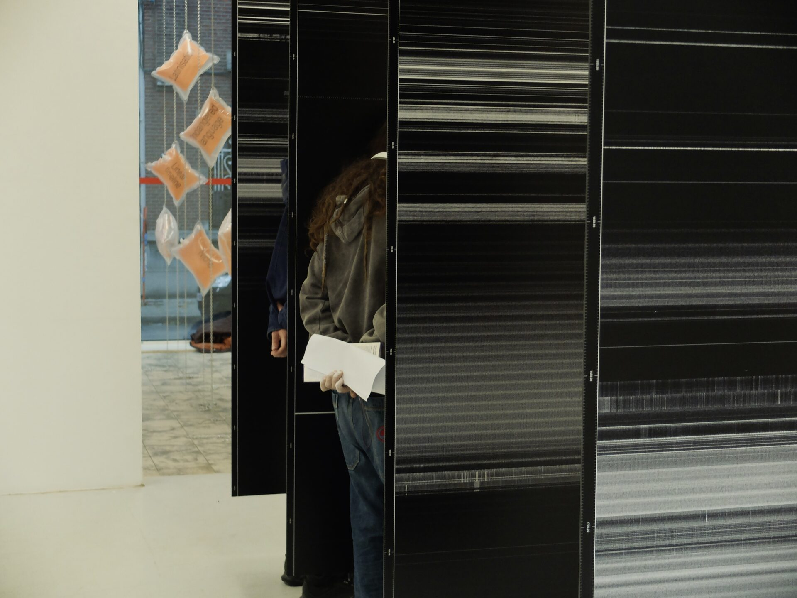
  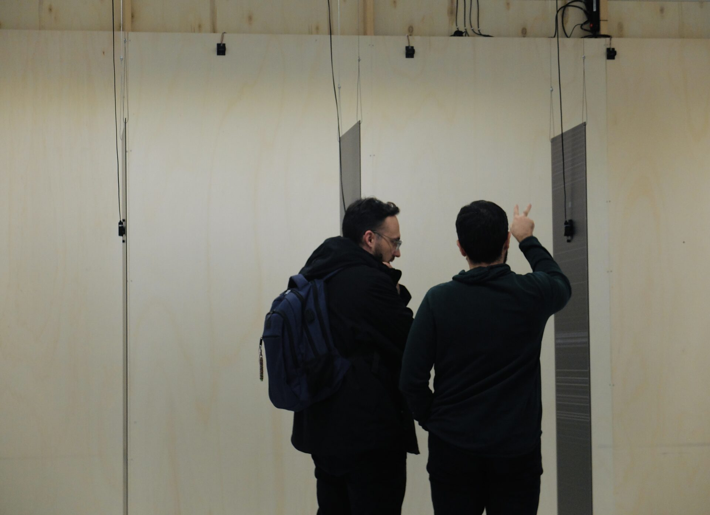

## Exhibition

- 2026, group exhibition: "SLARG Research Exhibition", Sint Lucas Antwerpen showroom, Antwerp (28 October – 1 November 2026)

### Credits

- **Hardware research & design:** Lieven Menschaert
- **Software & plate design:** Frederik De Bleser
- **Sonic development:** Cèlia Tort Pujol
- **Sonic development:** Myrthe Bokelmann
